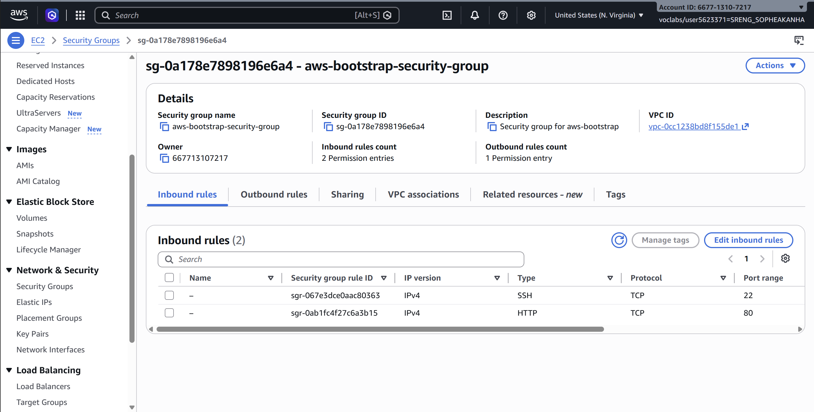
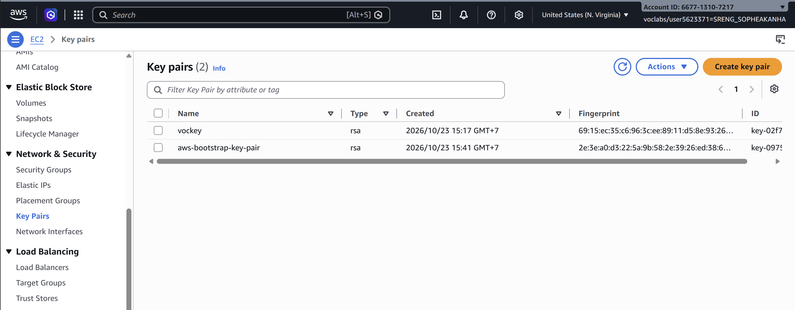
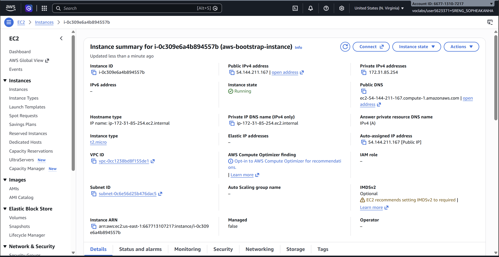
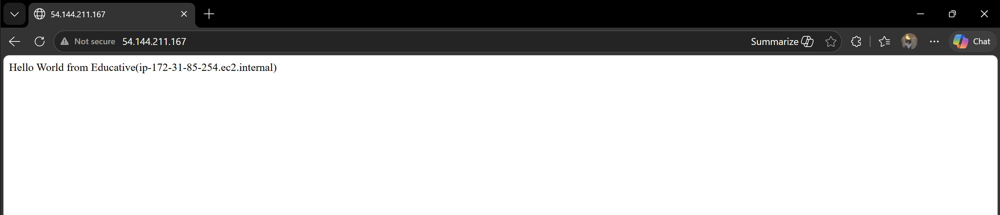
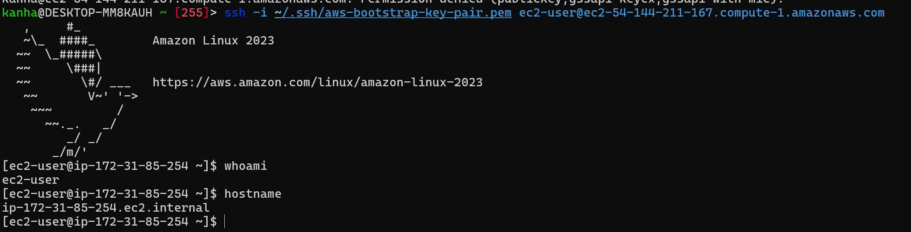
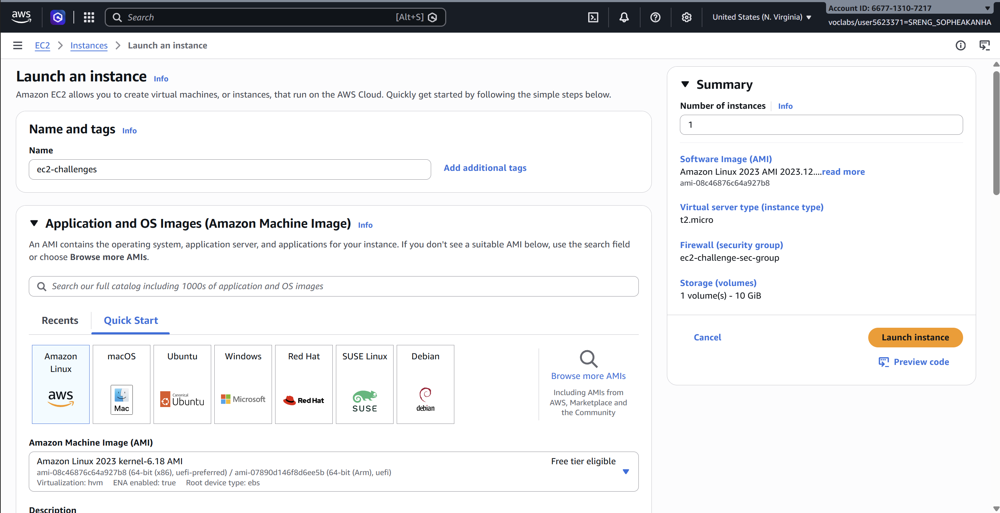
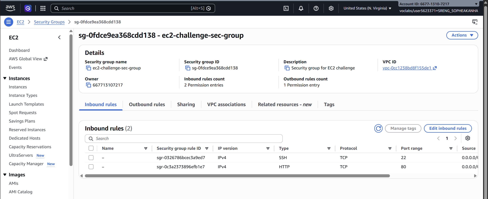
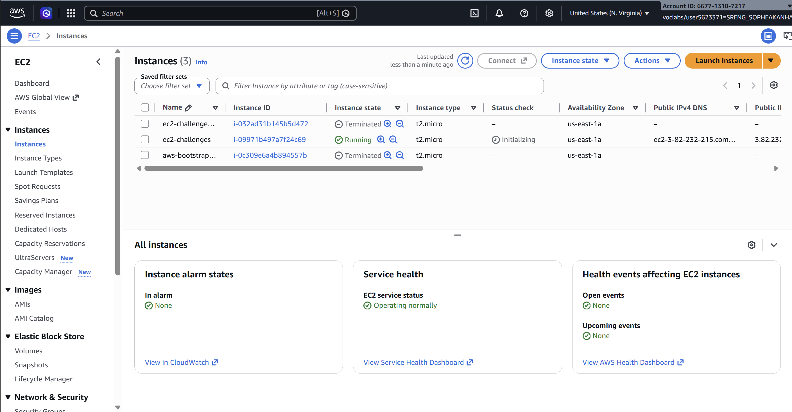
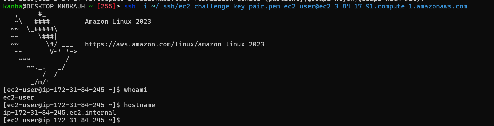
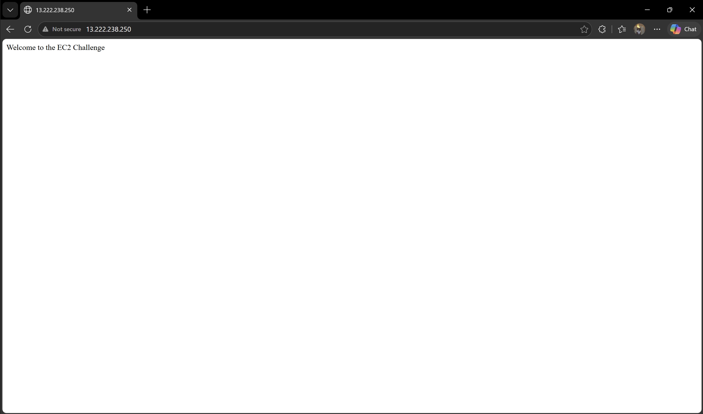

# Cloud Lab 1 Submission — Amazon EC2

Copy this template to `cc-lab-YOUR_ID/lab1/README.md` in your own repository. Follow [the instructions](lab1-instruction.md). Put your screenshots in `lab1/images/` with the file names below.

- **Student name: Sreng Sopheakanha**
- **Student ID: e20220477**
- **Learner Lab user name:**
- **Date completed:**

---

## Part 1.1 — An Amazon EC2 Walkthrough

### Security group



### Key pair



### Instance details



### Browser test



### SSH connection



I used my own SSH client.

---

## Part 1.2 — EC2 Web Solution (Challenge)

### Launch configuration



### Security group



### Running instance



### Commands on the instance



Paste the commands you ran to install the web server and create `index.html`:

```bash
sudo dnf install -y httpd
sudo systemctl start httpd
sudo systemctl enable httpd
echo "Welcome to the EC2 Challenge" | sudo tee /var/www/html/index.html
```

### Browser test



---

## Questions

1. Your security group has an SSH rule and an HTTP rule. What does each one let you do? What would stop working if you deleted the HTTP rule?

The SSH rule (port 22) lets me open a remote terminal on the instance, 
from my own SSH client or from EC2 Instance Connect. 
The HTTP rule (port 80) lets a browser reach the web server. 
If I deleted the HTTP rule, the web page would stop loading and the browser would time out, even though Apache would still be running on the instance. 
SSH would keep working.

2. In Part 1.1 you never logged in to install the web server. What installed it, and when did it run?

The user data script installed it. 
EC2 runs this script automatically, as root, the first time the instance boots 
(at launch, through cloud-init). 
It updated the system, installed httpd, started and enabled the service, 
and created index.html. That’s why I had to wait a minute or two after the 
instance showed Running before the page loaded.

3. Why does the web page open with `http://` but not with `https://`?

The web server only listens on port 80 (HTTP). 
I didn’t install a TLS certificate or configure HTTPS, 
so nothing answers on port 443. 
My security group also has no rule for port 443.

4. Part 1.2 asked for a 10 GiB root volume. Where in the launch settings did you set it, and how can you check the size on the running instance?


The setting is in the Configure storage section of the Launch instance page, 
where the root volume size is changed from the default 8 GiB to 10 GiB. 
I first launched with 8 GiB by mistake, so I fixed it afterwards with Modify volume and extended 
the partition and filesystem. I can check the size in the EC2 console on the instance’s Storage tab, 
or on the instance with lsblk or df -h /. The usable space shows slightly under 10 GiB.

## Problems and how I solved them (optional)

## AI note (optional)

One suggestion an AI tool gave you and how you checked it.

## Clean up

- [x] Part 1.1: instance terminated, key pair and security group deleted.
- [x] Part 1.2: instance terminated, security group (and key pair, if any) deleted.
