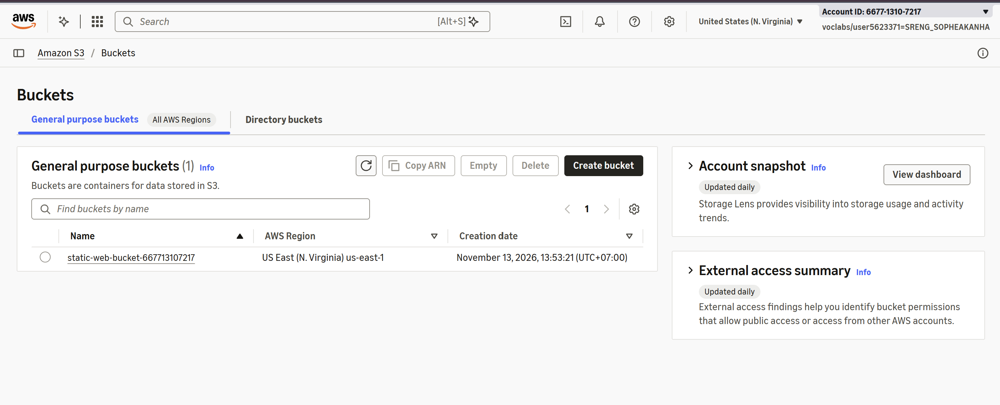
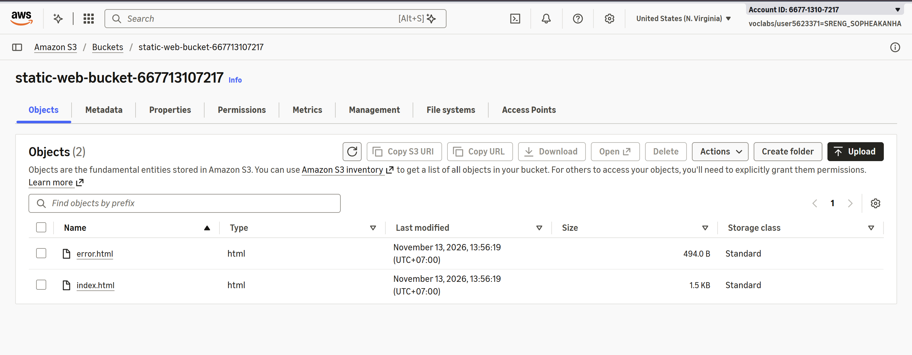
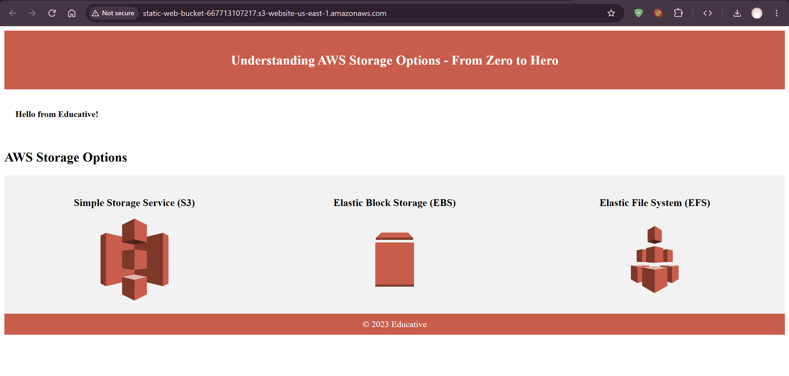
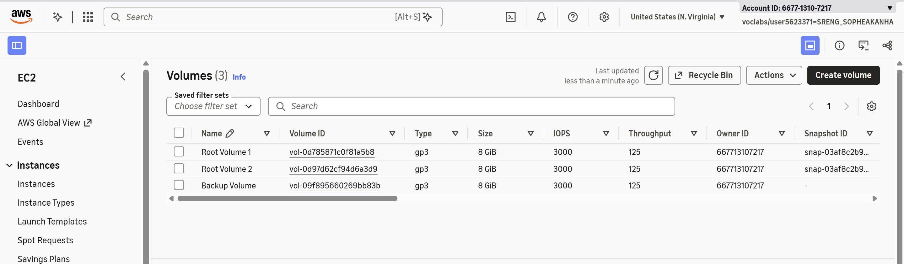
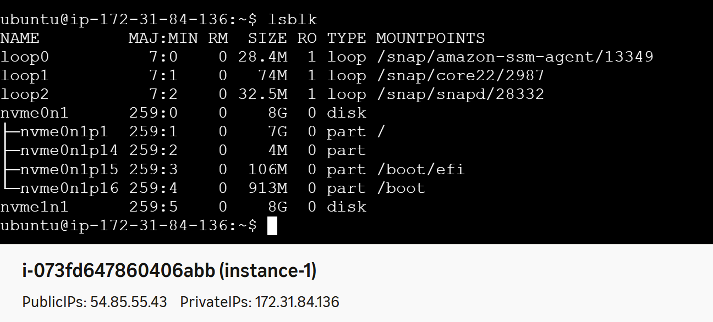
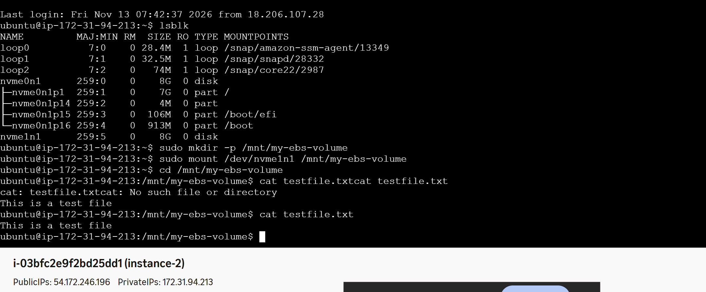
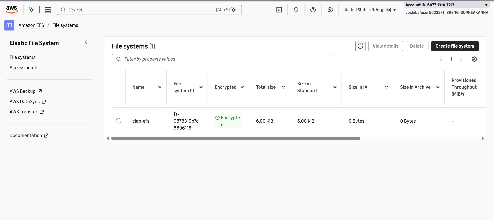
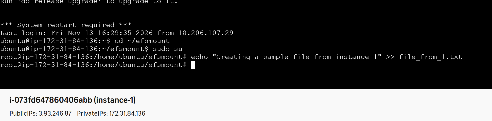
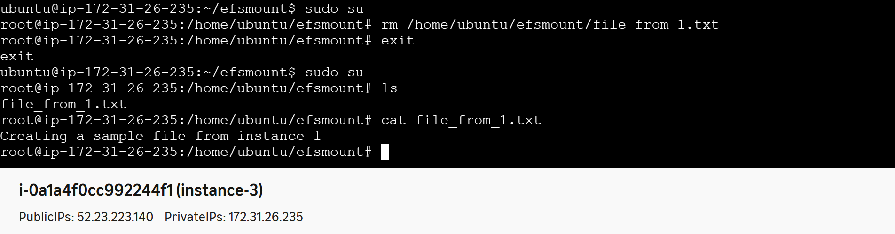

# Cloud Lab 3 Submission — AWS Storage Options

Copy this template to `cc-lab-YOUR_ID/lab3/README.md` in your own repository. Follow [the instructions](lab3-instruction.md). Put your screenshots in `lab3/images/` with the file names below.

- **Student name:**Sreng Sopheakanha
- **Student ID:** 20220477
- **Learner Lab user name:** SRENG_SOPHEAKANHA
- **Date completed:** 2026-11-13

---

## Part 2.1 — Amazon S3

### Bucket list

### Uploaded files

### Static website

---

## Part 2.2 — Amazon EBS

### Volumes page

### Attached volume (`lsblk`)

**My volume get `nvme1n1` device.**

### File read on instance-2

---

## Part 2.3 — Amazon EFS

### File system and mount targets

### File created on instance-1

### File listed on instance-3

---

## Answers to questions

1. After turning on static website hosting, the endpoint first returned **403 Forbidden** because the S3 objects were not publicly readable. After adding the bucket policy, anonymous users were granted `s3:GetObject` permission, so the website endpoint could serve the files.

2. `testfile.txt` was still there because it was stored on the separate **EBS Backup Volume**, which was detached from `instance-1` and attached to `instance-2`. A file saved on `instance-1`'s **root** volume would normally have been deleted when `instance-1` was terminated, because the root volume usually has **Delete on termination** enabled.

3. I ran `mkfs` on `instance-1` because the new EBS volume was empty and needed a filesystem before it could be mounted. I did not run `mkfs` on `instance-2` because it used the same volume, which was already formatted. Running `mkfs` again could have erased `testfile.txt`.

4. `instance-1` and `instance-3` could use the EFS file system at the same time because EFS is a shared network file system that supports concurrent access from multiple EC2 instances. An EBS volume normally has to be detached before attaching it to another instance. The instances had to be in subnets with EFS mount targets so they could connect to the file system through the VPC network. Security groups also had to allow NFS traffic on port 2049.

5. (a) **S3** for a website's images, because it provides durable and scalable object storage for static files. (b) **EBS** for the disk of a database server, because it provides block storage that can be attached to the database instance. (c) **EFS** for a folder shared by several web servers, because multiple instances can mount and use it at the same time.

## Problems and how I solved them (optional)

## AI note (optional)

One suggestion an AI tool gave you and how you checked it.

## Clean up

- [X] Instances `instance-1`, `instance-2`, `instance-3` terminated.
- [X] `clab-efs` and **Backup Volume** deleted.
- [X] Security groups `efs-sg` and `ec2instances-sg` deleted.
- [X] S3 bucket emptied and deleted.
