# Cloud Lab 4 Submission — Amazon VPC

- **Student name: Sreng Sopheakanha**
- **Student ID: e20220477**
- **Learner Lab user name: SRENG_SOPHEAKANHA**
- **Date completed: 06/11/2026**

---

## VPC and internet gateway

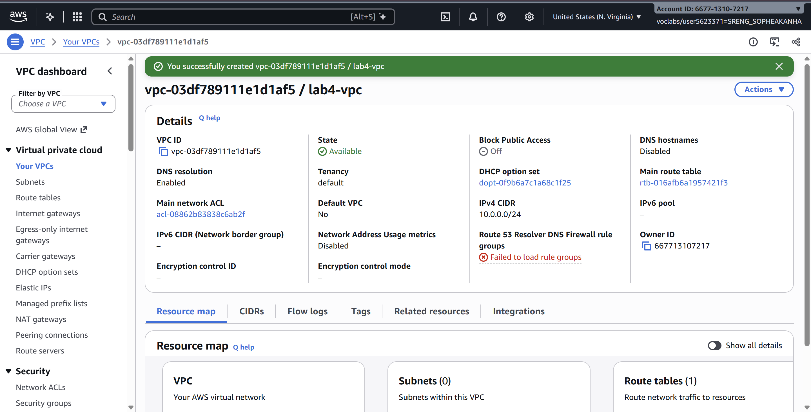

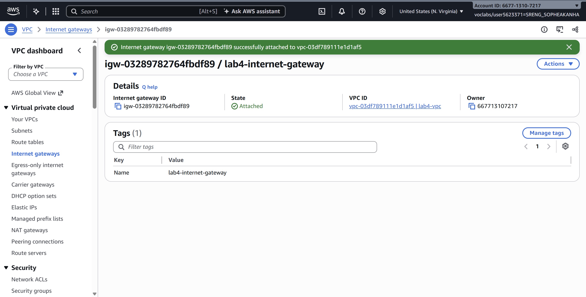

## Public subnet

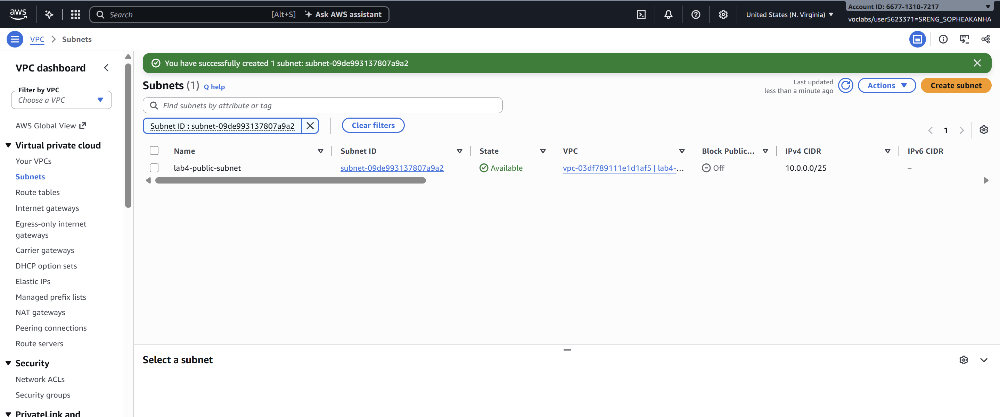

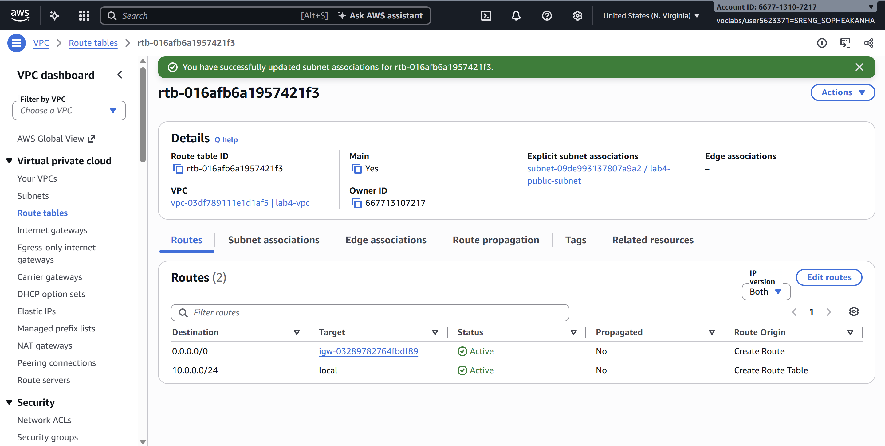

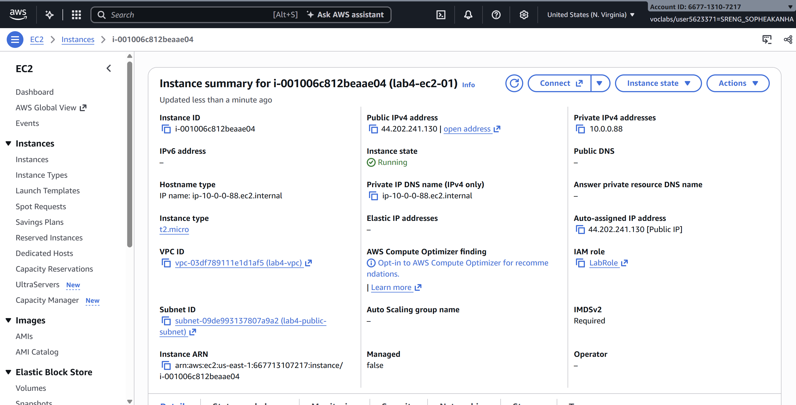

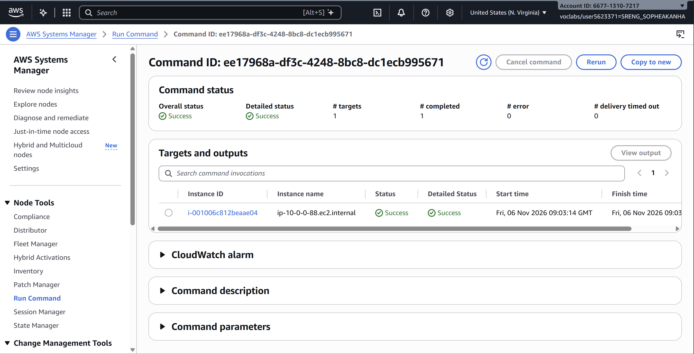

## Private subnet

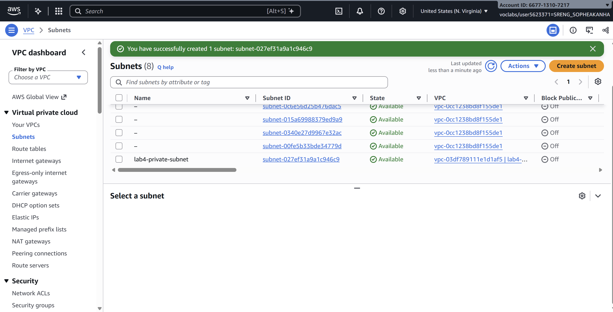

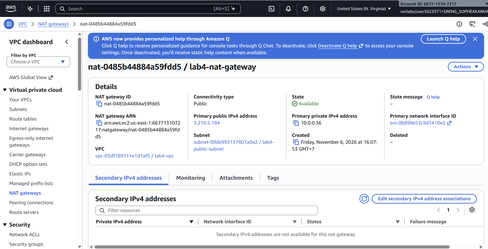

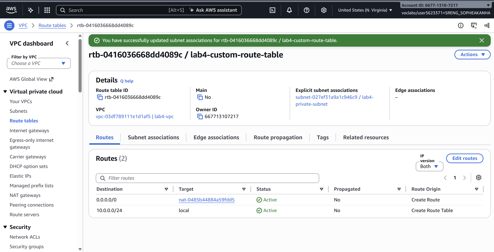

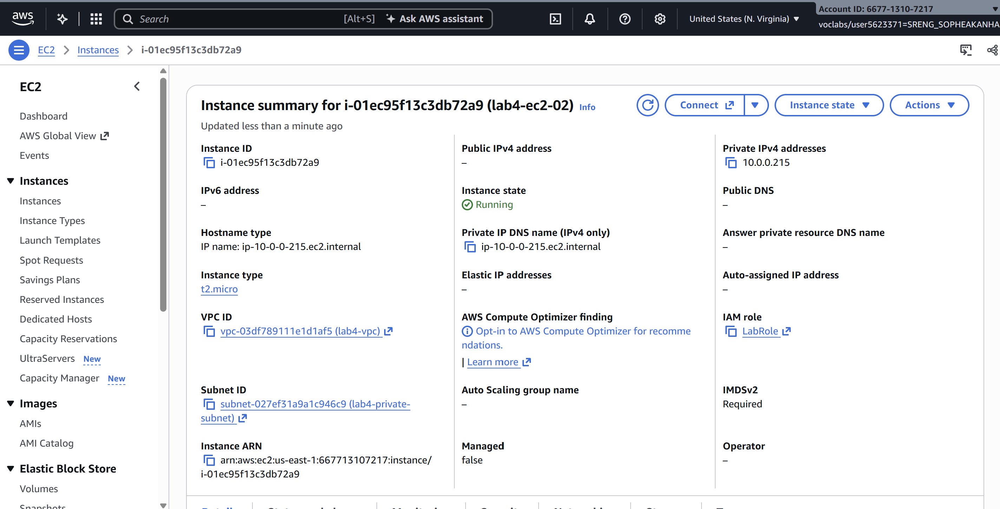

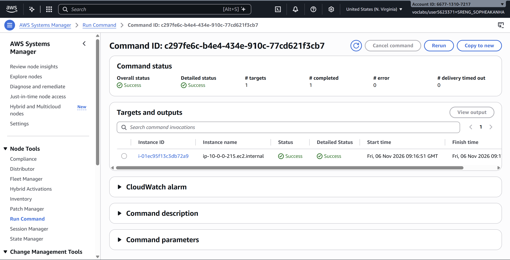

---

## Questions

1. The VPC is `10.0.0.0/24` and the subnets are `10.0.0.0/25` and `10.0.0.128/25`. How many IP addresses does each block contain, and why do the two subnets not overlap?

→ /24 block has 2^(32−24) = 256 addresses, and each /25 has 2^(32−25) = 128. 
The two subnets don’t overlap because their ranges are separate. 
10.0.0.0/25 covers 10.0.0.0 to 10.0.0.127, and 10.0.0.128/25 covers 10.0.0.128 to 10.0.0.255. 
No address belongs to both, and together they fill the whole VPC block. 
(AWS reserves 5 addresses in each subnet, so 123 are usable in each.)

2. Both subnets are in the same VPC. What exactly makes `lab4-public-subnet` public and `lab4-private-subnet` private?

→ Both subnets share the same VPC and the same local route, so the difference is routing. 
lab4-public-subnet is public because its route table has 0.0.0.0/0, internet gateway (lab4-internet-gateway), and its instance gets a public IP. 
ab4-private-subnet is private because its route table (lab4-custom-route-table) sends 0.0.0.0/0 only to the NAT gateway, 
with no direct route to the internet gateway. Its instance also has no public IP.

3. Why is the NAT gateway placed in the **public** subnet and not in the private one?

→ The NAT gateway needs its own path to the internet, 
which means an Elastic IP and a route to the internet gateway. Only the public subnet has that route. 
Traffic flows from the private instance to the NAT gateway in the public subnet, then through the internet gateway to the internet. 
If the NAT gateway were in the private subnet, its only route out would point to itself, so it could not reach the internet.

4. `lab4-ec2-02` has no public IP address. Can someone on the internet open a connection to it? Can it download updates? Explain both answers.

- Inbound from the internet: no. The instance has only a private address (10.0.0.128/25 range), which is not routable on the internet. The NAT gateway only handles traffic that the instance starts itself. Its security group also has no inbound rules.
- Downloading updates: yes. The instance sends requests to the NAT gateway through its 0.0.0.0/0 route. The NAT gateway replaces the private source address with its Elastic IP and forwards the traffic through the internet gateway. The replies come back the same way, so sudo yum update -y succeeded in Task 11.

5. You tested internet access with Systems Manager instead of SSH. Why did the instances need `LabInstanceProfile` for this?

→ Systems Manager Run Command doesn’t connect inbound to the instance, and these instances had no inbound security group rules. Instead, the SSM Agent on the instance contacts the Systems Manager service and picks up commands. The agent needs IAM permissions to do this, and LabInstanceProfile attaches LabRole, which grants them. Without it, the instances would not appear as manageable targets in Run Command.

## Problems and how I solved them (optional)

## AI note (optional)

One suggestion an AI tool gave you and how you checked it.

## Clean up

- [X] Instances terminated.
- [X] NAT gateway deleted and its Elastic IP released.
- [X] Internet gateway detached and deleted.
- [X] `lab4-vpc` deleted.